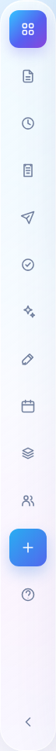
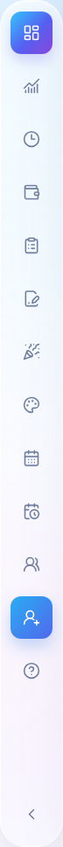
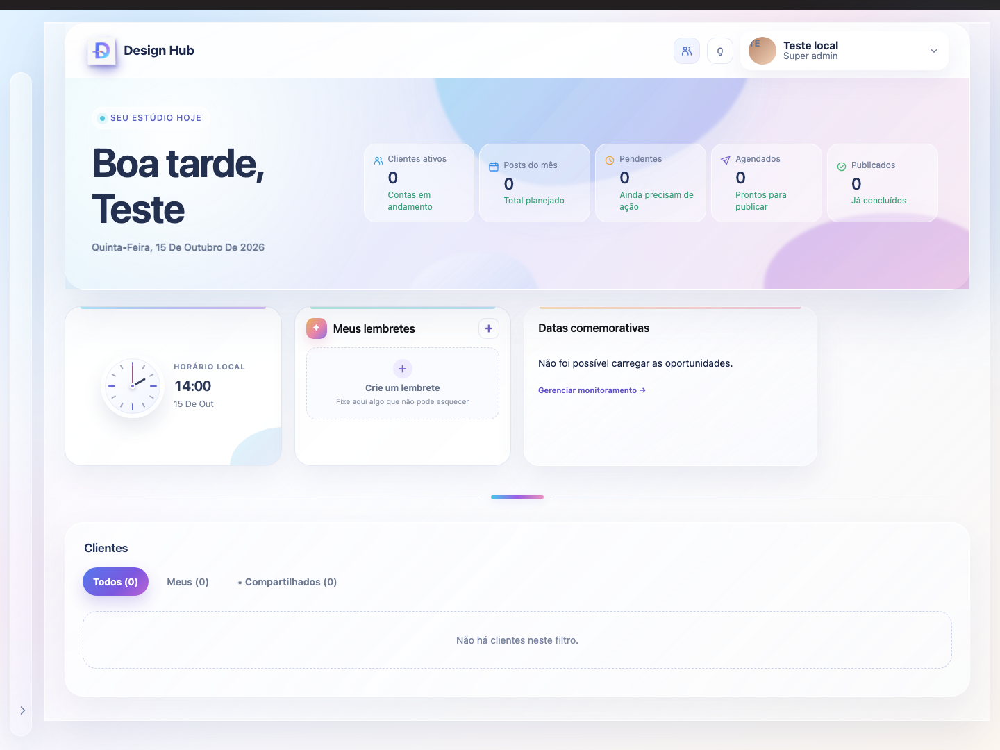
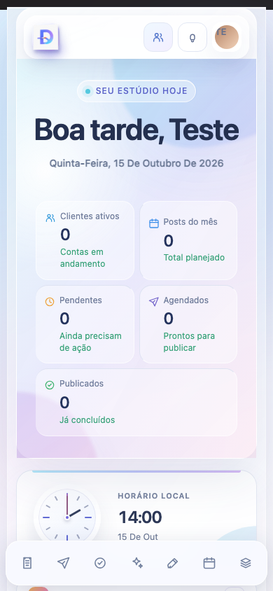
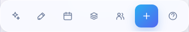
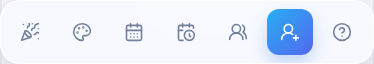

# Ícones da barra flutuante — comparação

Mudança exclusiva da `AdminRail`, baseada em `07723e36` da main. Os 13 desenhos seguem o mapeamento aprovado, usando `calendar-clock` para Publicações Meta. SVGs Lucide 0.462.0, com licença preservada, sem novas dependências. O controle de recolhimento continua usando o ícone anterior.

Rotas, ordem, ações, labels, tooltips, permissões e CSS permanecem intactos. Os nomes reais são **Briefs de design** e **Sobre**, preservados conforme o escopo. Os demais consumidores de `UiIcon` não mudam.

## Comparação

Capturas do aplicativo completo executado localmente, com sessão sintética de super_admin e todas as chamadas de API interceptadas. Desktop: 1440 × 1080; mobile: 390 × 844. Os widgets vazios/avisos de dados decorrem das respostas simuladas e não avaliam os módulos de negócio.

| Estado | Antes | Depois |
| --- | --- | --- |
| Desktop expandido (barra) |  |  |
| Desktop recolhido |  |  |
| Mobile, preferência expandida |  |  |
| Mobile, preferência recolhida |  |  |
| Mobile, fim da rolagem |  |  |

[Desktop completo antes](before/desktop-expanded.png) · [Desktop completo depois](after/desktop-expanded.png)

## Validação

- `npm --prefix v2 run check`: API e web aprovadas.
- `npm --prefix v2 run build`: API e web aprovadas; aviso já existente de bundles grandes.
- `npm --prefix v2 run test --workspace @design-hub-v2/api`: 694 testes aprovados.
- `npm --prefix v2 run test:rail --workspace @design-hub-v2/web`: 2 testes aprovados, cobrindo mapeamento, isolamento, SVGs distintos e atributos comuns.
- Navegador Chromium no build local: 16 cenários aprovados tanto antes como depois, combinando super_admin/admin/collaborator/client, desktop/mobile e preferência expandida/recolhida. Verificações: ordem, tooltips, nomes acessíveis, estado ativo, filtro global de permissões, tamanho/traço, persistência do recolhimento, abertura/fechamento de Sobre e abertura de Novo Cliente, sem envio do formulário. Clientes são redirecionados para a seleção de contas e não recebem AdminRail.

Para repetir as verificações de navegador, instale também as dependências de desenvolvimento da raiz (Playwright já declarado), sirva o build web local e execute:

```sh
RAIL_TEST_URL=http://127.0.0.1:4190 RAIL_SCREENSHOTS=docs/floating-sidebar-icons/after node v2/apps/web/tests/floatingRail.browser.mjs
```

Os testes do navegador sempre interceptam `/api/**` e recusam hosts fora de localhost. Não validam autorização de backend com contas reais.

## Limitação preexistente identificada

Em 390 px, a barra inferior existente centraliza a pilha de botões e corta os primeiros ícones à esquerda. A comparação **antes** já reproduz isso; o redesenho preserva as mesmas dimensões e posições. No mobile a preferência recolhida não oculta os ícones, por regra responsiva existente. No desktop recolhido, a pilha fica oculta e só aparece o controle de expansão. Nenhum CSS foi alterado neste PR. O teste confirma a renderização e as permissões existentes; não certifica que todos os controles mobile estejam alcançáveis pela rolagem.

Nenhum merge, deploy, migration ou mudança de produção foi executado.
