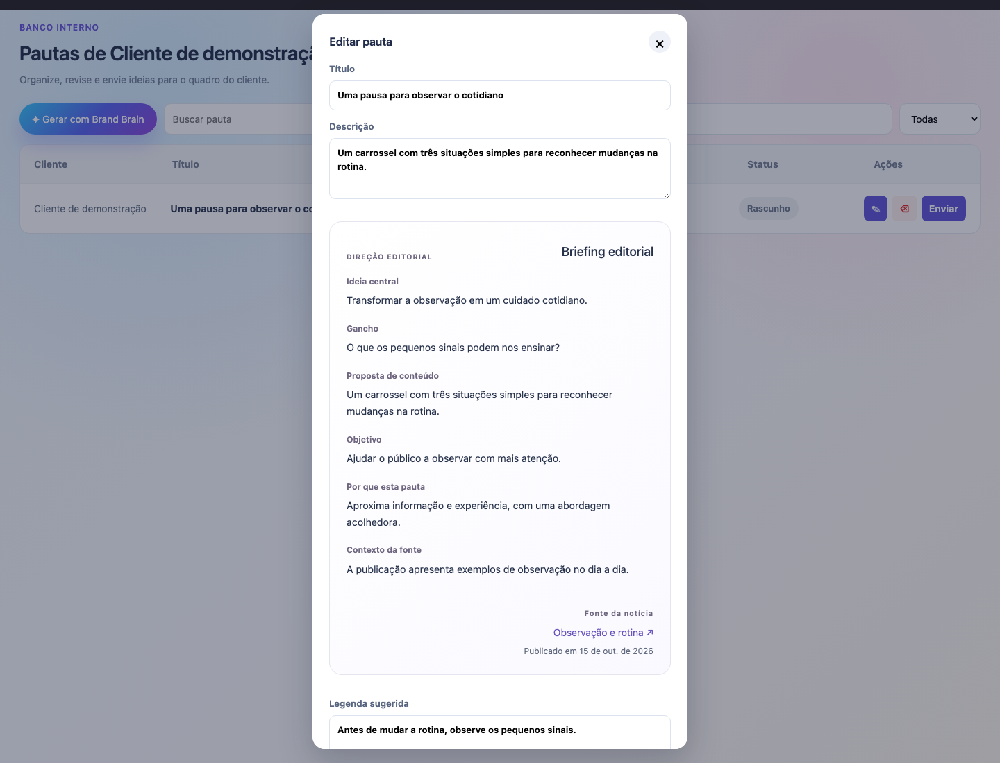
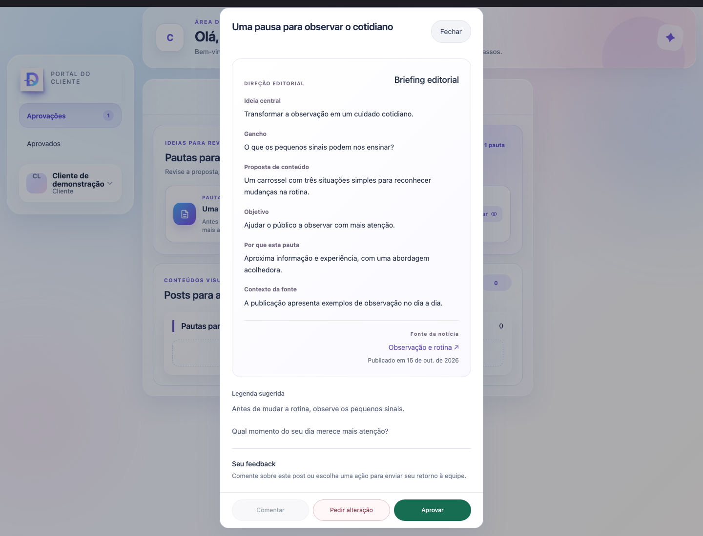
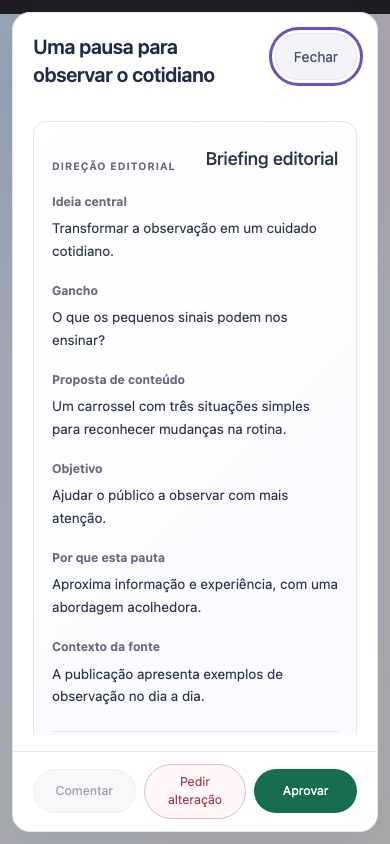
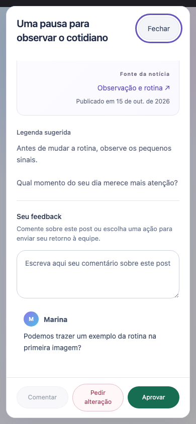

# Apresentação editorial das pautas — referência administrativa e portal

Base: `main` em `fa8f6d9e` (PRs #38, #39 e #40 incorporados). Branch e worktree próprias: `codex/editorial-pauta-design`.

## Referência e resultado

A referência é a janela real **Editar pauta** do Banco de Pautas, renderizada pela fixture com o mesmo código da aplicação. O componente `EditorialBrief` continua sendo o mesmo nas três experiências. A leitura mantém o fundo claro, borda suave, família tipográfica, espaçamento, cabeçalho de Direção editorial e fonte organizada da referência. Rótulos pequenos foram escurecidos para contraste, mantendo a paleta existente.

| Referência administrativa | Portal autenticado |
| --- | --- |
|  |  |

| Celular — início da pauta | Celular — comentários e decisões |
| --- | --- |
|  |  |

Mais capturas:

- [Link público no celular](pauta-design-evidence/public-mobile-light.png).
- [Kanban com briefing recolhido por padrão](pauta-design-evidence/kanban-collapsed-desktop-dark.png).
- [Kanban com briefing aberto](pauta-design-evidence/kanban-desktop-dark.png).
- [Recuperação em janela separada](pauta-design-evidence/recovery-desktop-dark.png).
- [Confirmação explícita da recuperação no celular](pauta-design-evidence/recovery-confirmation-mobile-dark.png).
- [Medições de estilo, responsividade e contraste](pauta-design-evidence/evidence.json).

## Portal e link público

A apresentação editorial é aplicada a pautas e cards com briefing editorial; cards comuns sem briefing mantêm sua apresentação anterior. No portal, a janela tem a mesma largura de 540 px da referência em desktop, limitada à tela no celular. A área de leitura rola separadamente do título e das ações. Comentar, pedir alteração e aprovar permanecem acessíveis no celular, incluindo depois de rolar até os comentários.

Badges, tags, papéis técnicos e o bloco redundante de metadados saem da leitura das pautas. Não há exibição de scores, modelo de IA, pilar ou notas internas. Campos ausentes não ganham texto inventado. Legenda e briefing mantêm os valores recebidos; somente a apresentação muda. Fontes continuam usando os links seguros existentes.

O leitor tem nome acessível, foco contido por Tab/Shift+Tab e fechamento por Escape. O link público mantém o contrato de decisão anterior. O acesso somente para leitura continua sem botões de decisão.

## Editor administrativo e recuperação

`AdminEditorialBrief` passa a ser uma seção `details` **fechada por padrão**, sem consulta automática de recuperação. Ao abrir, reutiliza o painel editorial claro com texto escuro, inclusive dentro do Kanban escuro.

A recuperação abre um `dialog` separado. Mantém consulta explícita, prévia completa para casos elegíveis, confirmação desmarcada inicialmente e o mesmo payload assinado de aplicação. Comparações e divergências ficam recolhidas. Se o servidor bloquear a recuperação, a janela mostra os motivos, sem uma prévia extensa de conteúdo recuperável.

A interface não oferece recuperação quando reconhece aprovação atual ou anterior, alterações solicitadas, publicação, agendamento ou arquivamento. Eventos e links já recebidos no detalhe do card são usados para reconhecer aprovação histórica; nenhuma consulta ou permissão nova foi criada. O servidor continua responsável por elegibilidade, permissões, comprovante, revisão e bloqueios.

O Escape de uma janela nativa aberta não deve acionar o salvamento/fechamento do editor ao fundo. Os handlers existentes foram ajustados para delegar a tecla ao dialog; o foco retorna ao botão que abriu a prévia. Nenhuma recuperação ocorre sem confirmação.

## Validação

Node **22.23.3**:

- **671 testes de regressão passaram**, zero falhas/skips, incluindo quatro novos casos para seção recolhida, proteção de estados/aprovação histórica e prévia bloqueada.
- **12 testes de navegador passaram**, zero falhas/skips, com componentes e clientes de API reais, respostas inteiramente sintéticas e rede externa bloqueada.
- Typecheck API/web e build API/web aprovados. Build mantém o aviso existente de tamanho de bundle.
- `git diff --check` aprovado.

Navegador: Chromium headless. Telas 1440×1100, 390×844 e 320×740, com preferências de cor clara e escura. O painel mantém a superfície clara aprovada, inclusive no editor administrativo escuro; não foi criado um tema ou identidade visual diferente.

Os testes conferem o mesmo fundo, fonte, padding, tamanho do texto e espaçamento do painel de referência. Os textos editoriais medidos tiveram contraste mínimo **5,1:1** sobre o extremo claro do gradiente. Também verificam ausência de overflow horizontal, conteúdo ausente, imagens, teclado, foco restaurado, aprovação, pedido de alteração, comentários, leitura sem permissão de decisão e confirmações de recuperação.

A fixture autenticada percorre restauração de sessão sintética → rota real do portal → abertura da pauta. As operações de decisão/recuperação são simuladas para conferir o payload, sem qualquer persistência real. As capturas foram inspecionadas visualmente. Os testes não acessam contas ou dados de produção.

## Preservação e entrega

Nenhuma alteração em serviços de API, permissões de servidor, contratos de request/response, banco ou migrations. Não há modificação de conteúdo, legenda, estados, revisões, comentários, snapshots, links ou histórico armazenados. Os fluxos dos PRs #38/#39/#40 permanecem no main usado como base.

O único ajuste no Banco de Pautas, além do estilo compartilhado, é o nome acessível dos botões de editar/excluir; sua aparência e comportamento são preservados. Os componentes de tela foram exportados para a fixture de navegador, sem adicionar rotas de produto.

Não houve merge do PR, deploy, migration, recuperação real ou alteração em produção.

Para reproduzir a partir de `v2` (Node 22):

```sh
npm --workspace @design-hub-v2/api test
npm --workspace @design-hub-v2/web run test:pauta-layout
npm run check
npm run build
```

O teste de navegador salva as capturas em um diretório temporário por padrão. `PAUTA_LAYOUT_ARTIFACT_DIR` permite escolher outro diretório local de evidências.
