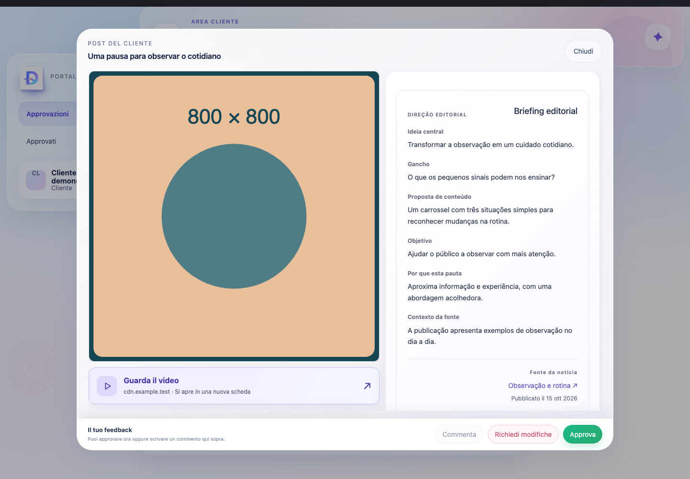
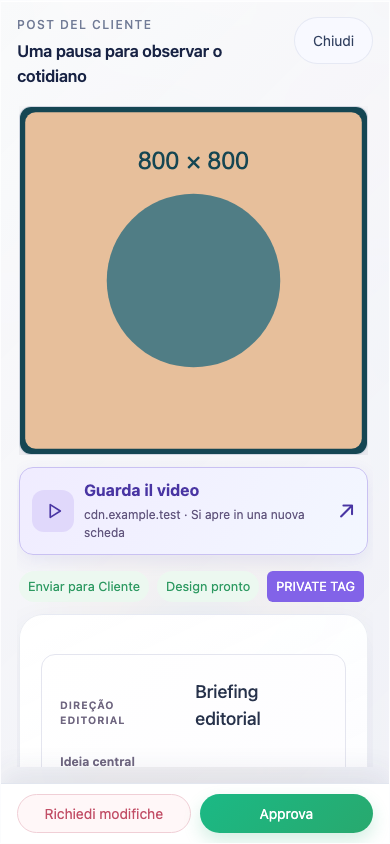

# Materiais externos no Portal do Cliente

A ação de abrir materiais agora ocupa toda a largura disponível, imediatamente abaixo da prévia e antes das etiquetas. Inclui ícone, título, domínio de destino e aviso de abertura em nova aba. Quando não há prévia, aparece no topo do conteúdo do leitor compacto existente.

O mesmo componente atende posts pendentes, aprovados e links públicos. O visualizador, a mídia, os estados dos cards, as legendas, hashtags, comentários e os controles de aprovação mantêm seu comportamento.

## Identificação e segurança

- Vídeos: extensão de arquivo no caminho (`mp4`, `webm`, `mov`, `m4v`, `ogv`) ou endereços reconhecidos de vídeos do YouTube/Vimeo.
- Links do Google Drive/Docs continuam genéricos, inclusive quando o post é um vídeo. O tipo da prévia não comprova o tipo do material externo.
- Italiano: **Guarda il video** / **Apri materiale**. Português: **Assistir ao vídeo** / **Abrir material**. Inglês, espanhol e sueco também localizados.
- URLs inválidas, esquemas fora de HTTP(S) e URLs com credenciais não viram ações clicáveis. A seleção de anexos Drive/Docs verifica o hostname exato.
- `target="_blank"` e `rel="noopener noreferrer"`; o endereço salvo é passado sem reescrita, incluindo query e fragmento.
- Ação nativa de link, operação por teclado, foco visível, ícones decorativos ocultos de leitores de tela, área mínima acima de 44px e quebra de domínios longos em telas estreitas.

## Capturas

Dados, imagens, comentários e materiais sintéticos; nenhuma chamada à produção. Capturas feitas com Chromium, desktop 1440×1000, mobile 390×844 e largura reduzida 320×844.

| Caso | Desktop | Mobile |
| --- | --- | --- |
| Pendente, material genérico | [1440px](screenshots/pending-1440.png) | [390px](screenshots/pending-390.png), [320px](screenshots/pending-320.png) |
| Aprovado, material genérico | [1440px](screenshots/approved-1440.png) | [390px](screenshots/approved-390.png), [320px](screenshots/approved-320.png) |
| Portal autenticado, vídeo em italiano | [1440px](screenshots/portal-it-video-1440.png) | [390px](screenshots/portal-it-video-390.png) |
| Sem prévia | — | [390px](screenshots/no-preview-mobile.png) |
| Link público | — | [Vídeo IT](screenshots/public-it-video-mobile.png), [Material IT](screenshots/public-it-material-mobile.png), [Vídeo PT](screenshots/public-pt-video-mobile.png) |





## Validação

Executar a partir da raiz do repositório:

```sh
npm --prefix v2/apps/web run test:portal-material
npm --prefix v2/apps/web run test:media-layout
npm --prefix v2 run check
npm --prefix v2 run build
```

- 28 testes de componente aprovados: cinco idiomas, identificação conservadora, preservação do endereço e bloqueio de URLs inseguras.
- 12 cenários de navegador aprovados: pendentes/aprovados em três larguras; material sem imagem; links públicos PT/IT; portal autenticado IT desktop/mobile.
- Verificado em navegador: posição antes das etiquetas; mídia, legenda, hashtags e comentários preservados; foco visível e ativação com Enter; nova aba sem `window.opener`; ausência de ações de aprovação ao abrir material; rascunho do comentário preservado; payloads de aprovação e pedido de alteração mantidos.
- Suíte existente `test:media-layout` aprovada: oito cenários de regressão de imagens, carrossel misto e vídeos reais em desktop/mobile, temas claro/escuro, portal autenticado e links públicos (nove testes incluindo o agrupador).
- Typecheck da API e da web aprovado.
- Build da API e da web aprovado. Vite mantém o aviso de chunks acima de 500 kB.

Para regenerar as capturas em uma pasta específica:

```sh
PORTAL_MATERIAL_ARTIFACT_DIR="$PWD/docs/portal-material-action/screenshots" npm --prefix v2/apps/web run test:portal-material
```

Escopo exclusivamente de apresentação e validação local. Sem merge, deploy, migration ou alterações em produção.
