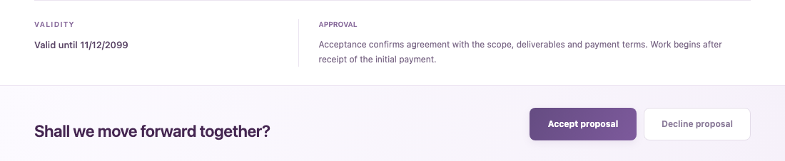
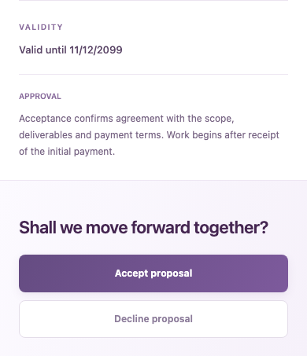

# Fechamento profissional da proposta

Ajuste restrito ao rodapé/CTA, motivado pelo desalinhamento entre validade, aprovação e botões. A seção de investimento compacta e os cards de pacotes não foram alterados.

- Validade exibida uma única vez na interface fixa; não modifica textos livres que eventualmente mencionem prazos.
- Validade e aprovação agrupadas, com rótulos e margens alinhados. Sem o nome do estúdio solto no canto oposto.
- Chamada final à esquerda e botões de mesmo tamanho à direita no desktop, em faixa lilás discreta.
- No celular, informação e ações empilhadas, com botões de largura total e boa área de toque.
- Estados de aceite, recusa, expiração, erro, seleção obrigatória e idiomas preservados. Nenhuma alteração em valores, datas persistidas, termos ou snapshots.

Node 22.23.4: typecheck/builds da API e frontend aprovados; 727 testes passaram. Chromium em 1440px/390px verificou validade fixa única, botões iguais/alinhados, ordem mobile, aceite de proposta única habilitado e ausência de overflow/erros. As regressões existentes verificam seleção de alternativas e aceite.

Arquivos: `proposalPresentation.tsx`, `PublicPremiumProposalPage.tsx`, `proposalPremium.css` e imagens/relatório. Sem dependências, API, banco ou migrations. Sem alterações no PR #54, Hostinger ou produção. Não publicado nesta etapa. Imagens usam fixtures, com data futura sintética.

