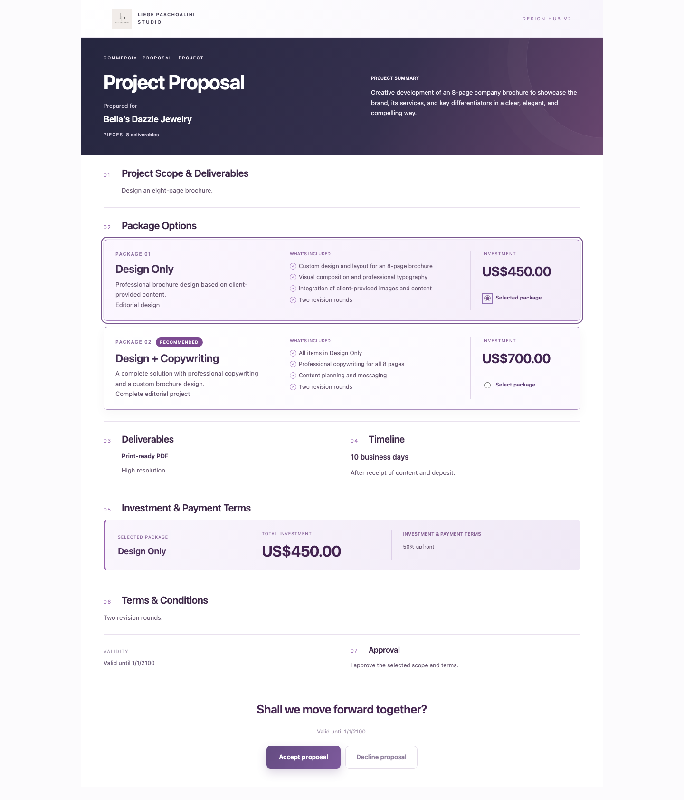
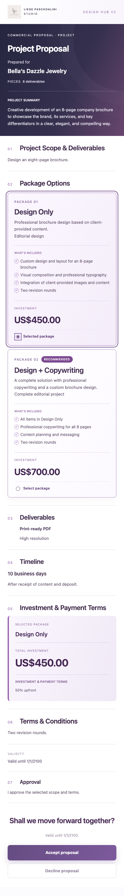

# Área do cliente — referência visual aprovada

Adaptação da apresentação de propostas à imagem enviada pelo usuário, “Proposta Comercial Elegante em Roxo.png”. Base em main após os PRs #58 e #59. Sem mudanças no editor, API, modelo de dados, migration ou fluxo financeiro.

## Visual

- Cabeçalho do estúdio com logo existente e Design Hub V2.
- Capa com gradiente roxo escuro, título/nome do cliente à esquerda e resumo real da proposta à direita. No celular, os blocos ficam empilhados.
- Tipografia sem serifa, títulos compactos e divisórias leves, conforme a referência.
- Pacotes em faixas horizontais com identidade/descrição, inclusões e investimento. Clique no card, radio acessível, destaque de seleção, badge e itens não incluídos preservados.
- Entregáveis e cronograma lado a lado quando ambos existem; empilhados no celular ou apresentados isoladamente quando só um foi preenchido.
- Faixa lilás com pacote escolhido, total e condições reais de pagamento. Sem escolha, mantém o estado neutro.
- Validade e texto de aprovação em duas colunas no desktop; CTA final com aceite/recusa e estados existentes.
- Campos opcionais continuam condicionados aos dados. Não são acrescentados automaticamente prazos, arquivos editáveis, revisões, meios de pagamento ou textos do mockup.
- Quatro moedas, idiomas, preços, tokens e snapshots anteriores continuam usando a implementação existente. As microanimações e prefers-reduced-motion foram preservados.

## Verificação

Node 22.23.4: typecheck e builds API/frontend aprovados; **724/724 testes existentes passaram**. Não foram adicionadas dependências ou testes artificiais para regras de CSS. A API não foi modificada e não foi necessário repetir a homologação SQL já registrada nos PRs anteriores.

Chromium em 1440px e 390px: cards clicáveis, seleção exclusiva, alternância de total US$450/US$700, teclado, bloqueio do aceite sem seleção, redução de movimento e revelação do CTA ao rolar; sem erros JavaScript ou overflow horizontal. Dados das imagens são fixtures fictícias, incluindo o nome de cliente do mockup para comparação visual; não foram salvos em propostas reais.

Arquivos alterados: `proposalPresentation.tsx`, `PublicPremiumProposalPage.tsx` e `proposalPremium.css`, além deste relatório e imagens.

Sem merge, deploy ou alterações na Hostinger/produção. PR #54 intacto. A referência original não foi modificada.

