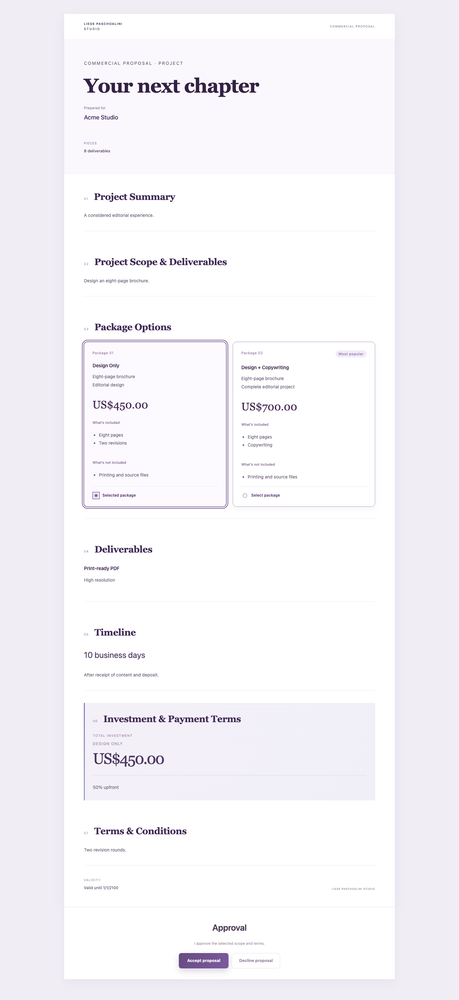
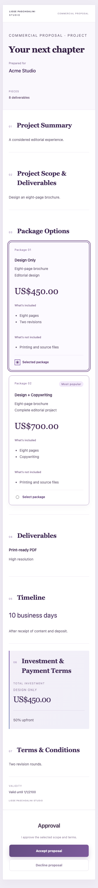

# Seleção premium de pacotes

Melhoria sobre o PR #58, já incorporado a main. Branch exclusiva `codex/proposal-package-selection`. Sem merge, deploy, alteração em produção ou no PR #54.

## Comportamento

- Package Options com cards clicáveis por inteiro e seleção única por radio nativo, também acessível pelo teclado. Indicadores de seleção, hover e foco visíveis.
- Título, subtítulo opcional, descrição, preço, itens incluídos/não incluídos e badge livre. A moeda é herdada da proposta e indicada no editor; não há conversão ou moedas diferentes dentro da mesma proposta.
- Estado neutro em Investment enquanto não houver escolha; após selecionar, Total Investment mostra somente aquele pacote, nunca a soma de alternativas. Add-ons continuam fora do total.
- Novo modo `packages` aceita um ou mais pacotes. Inclusive para pacote único, a escolha é explícita antes do aceite. O modo `alternatives` anterior continua válido com pelo menos duas opções; `single` mantém os serviços cumulativos legados.
- Aceite só habilita para proposta válida, enviada/visualizada e pacote pertencente ao documento atual. O servidor valida novamente e mantém o registro existente de ID/nome, preço, moeda, revisão e snapshot.
- No admin, resumo tem seção própria. Os demais campos permanecem organizados em seções expansíveis. A prévia permite testar a seleção sem salvar a escolha no documento.
- Ação explícita “Usar cada serviço atual como um pacote”: somente para propostas cujos serviços são alternativas. Copia nomes, descrições e preços; não altera a lista original, nem infere intenção comercial automaticamente. Valores positivos sem nome também são preservados.
- Rótulos públicos consistentes nos cinco idiomas; textos livres/badges permanecem como digitados. Em inglês: Package Options, What’s included, What’s not included, Project Scope & Deliverables, Investment & Payment Terms, Select package, Accept proposal e Decline proposal.
- Reveal de 300ms/10px no scroll para seções, cards, investimento e CTA. Conteúdo visível sem IntersectionObserver; preferência de movimento reduzido é respeitada inclusive quando alterada durante a leitura. Sem bibliotecas novas. A aprovação pública é exibida uma única vez junto ao CTA.

## Dados e compatibilidade

**Nenhuma nova migration.** Reutiliza `proposal_documents.document_json` e `acceptance_json`, existentes desde o PR #58. Novos campos opcionais por opção: `subtitle`, `excludedItems` e `badge`; nenhum default é materializado em documentos antigos. O modo `packages` é um valor JSON, sem enum SQL a alterar.

Não há backfill nem UPDATE de propostas históricas. Documentos legados sem esses campos renderizam normalmente. Aceites anteriores continuam usando a opção e o snapshot registrados. Serviços legados não são convertidos automaticamente, pois podem ser cumulativos.

Para uma proposta antiga que realmente contém Design Only 450 e Design + Copywriting 700, abrir o editor e usar a ação explícita de criação de pacotes; conferir os cards e salvar. A alteração continua sujeita às regras de revisão e imutabilidade após aceite.

API e frontend devem ser publicados juntos após revisão/autorização: versões antigas não conhecem o novo modo JSON. Em eventual rollback para código antigo, bloquear novos aceites de propostas com `mode=packages`; preservar todos os documentos e snapshots. Esta entrega não executou publicação ou rollback.

## Verificação

Node 22.23.4:

- Typecheck API/frontend e builds API/frontend aprovados.
- Suíte geral: **724/724 testes aprovados**.
- MariaDB real **11.8.9**: **17/17 testes SQL aprovados**, incluindo os quatro ciclos adicionais de pacote único nas moedas BRL/USD/EUR/SEK, criação/edição/recarga, metadados opcionais e snapshot do aceite.
- Regressões de propostas antigas, alternativas, exclusividade financeira, opção inválida/de outra proposta, versão desatualizada, duplicidade, rollback, autenticação e imutabilidade mantidas.
- Teste de UI cobre um e vários pacotes, bloqueio do aceite, envio do ID/revisão e ação de conversão explícita preservando preços/lista original. Teste do hook cobre entrada no viewport, mudança de preferência de movimento e desconexão de observers.
- Chromium em 1440px e 390px: clique no card, seleção exclusiva, totais 450/700, teclado, bloqueio/liberação do CTA, movimento reduzido e scroll; sem erros JavaScript ou overflow horizontal. Imagens com dados sintéticos abaixo.

A instância SQL era temporária, com socket exclusivo e rede desabilitada, sem `.env` ou credenciais da aplicação. Zero bancos de testes restantes; servidor encerrado e datadir removido. Evidência: [mysql-evidence.json](mysql-evidence.json). Mesma versão registrada na auditoria de produção; configuração viva de produção não foi reconsultada. Limites de collation/case sensitivity/timezone seguem o relatório de homologação do PR #58.

Vite mantém o aviso de tamanho dos chunks. Nenhuma dependência de runtime ou testes foi adicionada. A inspeção Chromium usou a instalação de Playwright já disponível na máquina, sem incorporá-la ao projeto/build.

