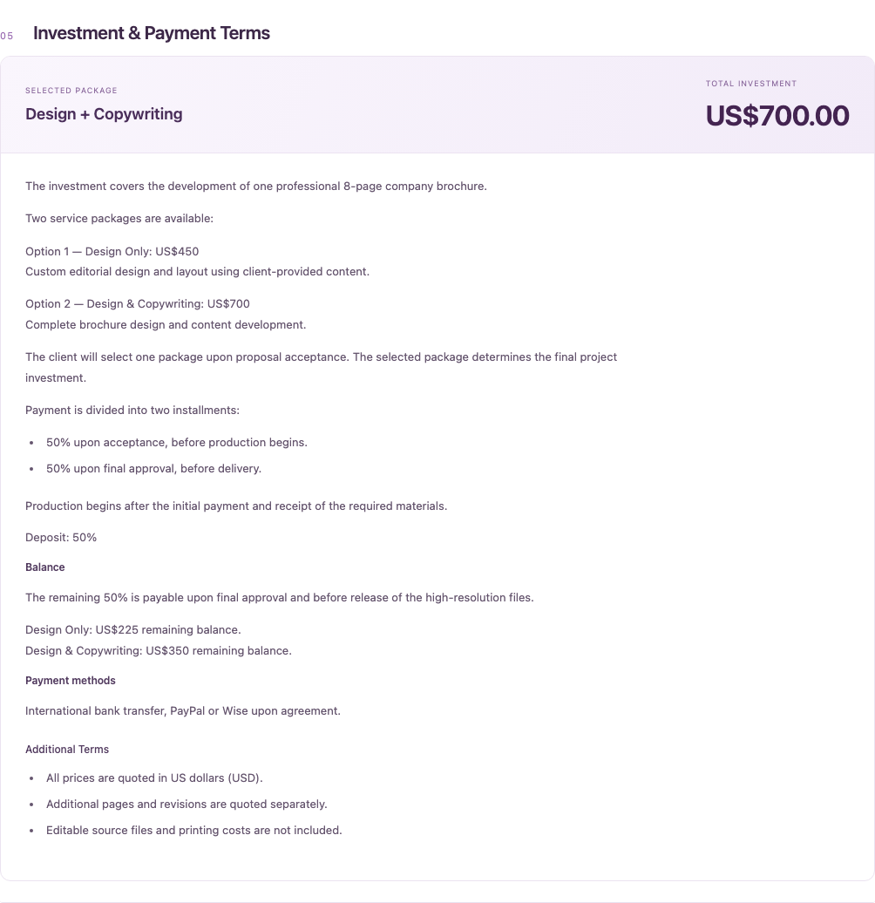
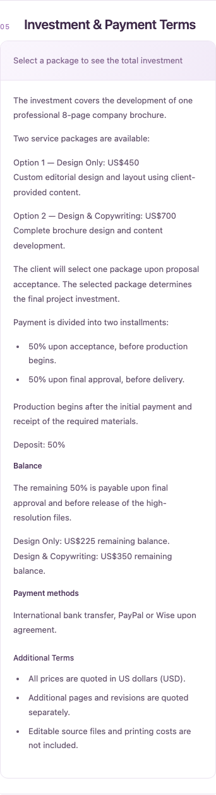

# Investimento e condições de pagamento

A seção antes esticava o resumo do investimento à altura do texto longo e deixava uma grande coluna vazia. Agora o resumo fica numa faixa lilás compacta no topo; as condições ocupam a largura útil abaixo, em fundo branco. O título fixo duplicado foi removido.

Parágrafos, listas com hífen/asterisco e negrito simples são apresentados com marcação semântica. O renderer não executa HTML, não interpreta links e não usa dependências novas. Textos originais, preços, percentuais, serviços, aceites e dados persistidos não são modificados. Não há cálculos financeiros novos, banco ou migration.

Seleção de pacote e estado neutro permanecem: sem escolha, texto de apoio no topo; após escolher, nome e total aparecem na mesma faixa. Termos não mudam durante a seleção. No celular tudo fica em uma coluna, sem espaços artificiais.

Validação Node 22.23.4: typecheck/builds API e frontend aprovados; 726 testes passaram. Dois novos testes verificam parágrafos/listas/negrito, preservação dos valores, escape de HTML e conteúdo vazio. Chromium a 1440px e 390px verificou texto longo, estado neutro/selecionado, ausência da coluna vazia, título não repetido, termos intactos após seleção, aceite bloqueado antes da escolha e ausência de overflow/erros JavaScript.

A alteração se limita à apresentação e CSS das propostas, ao pequeno renderer de texto e à sua inclusão na suíte existente. Sem alterações no PR #54, outros módulos, produção ou Hostinger. Imagens usam dados fictícios. Não publicado nesta etapa.

