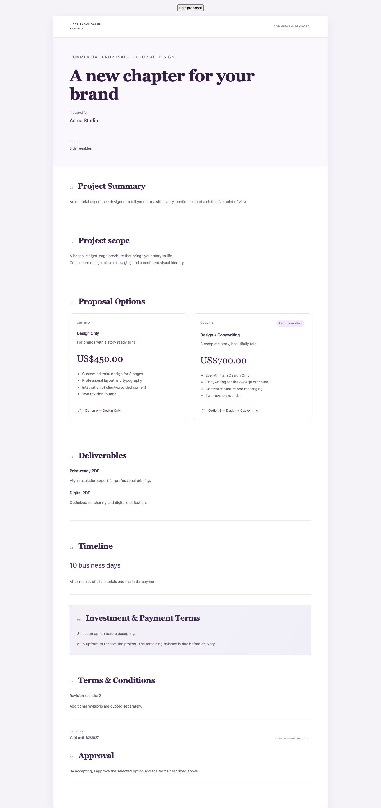
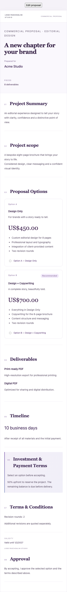
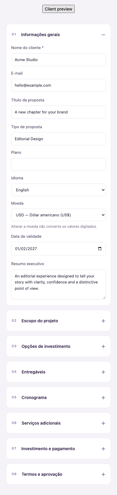

# Propostas comerciais premium — revisão

Implementação integrada do editor e do documento público. PR deve permanecer em rascunho, sem merge/deploy até aprovação da estrutura de dados. Não altera faturas, contratos, pagamentos, relatórios, Hostinger ou PR #54.

## Comportamento

- Oito seções expansíveis: informações gerais, escopo, opções, entregáveis, cronograma, adicionais, pagamento e termos.
- Título personalizado na capa; tipo livre, idioma, moeda e validade editáveis.
- Modo único conserva os serviços e valores anteriores. Alternativas possuem IDs estáveis, itens, recomendação e ordenação; nunca são somadas.
- O cliente seleciona uma alternativa antes de aceitar. A API determina o preço no servidor; não aceita preço enviado pelo cliente.
- Add-ons são apenas informativos para contratação posterior, excluídos do valor aprovado.
- Todos os campos adicionais são persistidos, incluindo títulos de seção, condições, entrada, saldo, métodos de pagamento e materiais do cliente. Seções opcionais vazias não aparecem.
- Português, inglês, espanhol, italiano e sueco: rótulos públicos e tipos padrão localizados. Textos livres não são traduzidos. Moeda independente do idioma, sem conversão, preservando PR #57.
- A validade escolhida é preservada ao enviar, sem renovação automática.
- PATCH não reaplica defaults de campos omitidos, evitando apagar dados em atualizações parciais.

## Persistência e aceite

A tabela complementar `proposal_documents` armazena `document_json`, `revision` e `acceptance_json`, vinculada à proposta existente. Não há backfill ou regravação das propostas históricas.

O aceite guarda opção, nome, valor, moeda, revisão, data e snapshot completo das condições/documento. Alterações e decisões usam transação com bloqueio da linha da proposta. Uma versão desatualizada, opção inexistente/de outra proposta, proposta expirada, rascunho ou nova decisão após aceite/recusa são rejeitados. Propostas aceitas não podem ser editadas ou excluídas, preservando a evidência de aprovação. Revisões posteriores exigem nova proposta.

## Banco: aprovação obrigatória antes de merge

SQL proposto: [`20261105_proposal_documents.sql`](../../v2/database/migration-proposals/20261105_proposal_documents.sql). **Não executado.** O arquivo fica fora das migrations automáticas. Não há nova DDL no startup.

Antes da aprovação, leituras legadas continuam funcionando caso a tabela não exista. Escritas premium e novos aceites exigem a tabela; se ausente, a API responde 503 sem salvar parcialmente. Portanto, não publicar a nova aplicação sem a estrutura aprovada e aplicada por operação autorizada.

Ordem futura, mediante autorização: backup; testar SQL em MySQL de homologação; aprovar o schema; aplicar tabela; publicar API e frontend juntos; validar proposta antiga e nova. Nenhum desses passos de produção foi executado.

Rollback: reverter aplicação primeiro, exportar/preservar `proposal_documents` com documentos e aceites; manter a tabela até decisão explícita de remoção. O código antigo ignora a tabela, mas não conhece alternativas; durante rollback, impedir novos aceites de propostas premium para evitar ambiguidade financeira.

## Arquivos

- API propostas: schemas, repositório, rotas e novo repositório de documentos/aceites.
- Frontend: integração mínima em App/api, editor, modelo de documento, página pública, apresentação, textos fixos e CSS restrito a propostas.
- Testes: cobertura premium, manutenção das regressões do editor e do hotfix de moedas, inclusão no comando de testes existente; nenhuma dependência de runtime/testes adicionada.
- SQL separado e este relatório com imagens de revisão.

## Verificação e limites

Node 22.23.4: typecheck e builds API/frontend passaram; suíte completa: **722/722 testes passaram**. Vite mantém aviso de tamanho de chunks. Nenhuma dependência nova foi introduzida.

Testes cobrem persistência completa com banco simulado, atualizações parciais, revisões concorrentes, opções inválidas, preço derivado no servidor, exclusividade financeira, snapshot, aceite repetido, UI de seleção e quatro moedas × cinco idiomas. Regressões das propostas antigas permanecem na suíte.

Verificação em Chromium a 1440px e 390px: editor e apresentação sem overflow horizontal ou erros JavaScript; seleção de US$450 produz apenas esse total. Imagens abaixo mostram dados fictícios.

Não foi usado banco real nem executada migration; homologação do SQL em MySQL continua pendente para a etapa de aprovação. PDF e duplicação por interface não existem no módulo atual e não foram acrescentados neste redesign.

O pedido completo, incluindo as seções 7 (testes) e 8 (entrega), foi recebido e conferido. Não foi fornecido um arquivo identificável do mockup aprovado; o visual segue a direção escrita (branco, lilás, roxo profundo e hierarquia editorial).

### Cobertura dos testes obrigatórios

| Requisito | Evidência |
| --- | --- |
| Proposta única existente e integridade dos dados antigos | Regressões em `proposalsWorkspace.test.tsx` e `proposalCurrency.test.ts`; serviços e valores anteriores preservados. Sem acesso ou alteração de registros de produção. |
| Duas alternativas sem soma automática | `proposalPremium.test.tsx`: preços independentes, ausência de total antes da seleção e total somente da alternativa escolhida. |
| Salvar e recarregar | Teste de criação, atualização e reabertura pelo repositório, com todos os campos premium e valores legados, usando banco simulado. |
| Exibição pública e seleção no aceite | Renderização pública e teste de interação: botão bloqueado sem escolha, envio do ID e revisão, confirmação após aceite. |
| Valor e termos aceitos | Testes de snapshot completo, preço determinado no servidor, concorrência, aceite repetido e bloqueio de alterações após aprovação. |
| BRL, USD, EUR e SEK | Hotfix de moedas preservado e matriz de renderização nas quatro moedas e cinco idiomas. |
| Elementos fixos em inglês | Renderização em inglês sem os padrões portugueses “Projeto” e “Personalizado”; conteúdo livre preservado. |
| Responsividade | Chromium em 1440px e 390px, sem overflow horizontal ou erros JavaScript; imagens anexadas. |
| Typecheck, builds e suíte existente | Node 22.23.4: API e frontend aprovados, 722 testes aprovados incluindo as novas funcionalidades. |

A validação com MySQL real continua pendente; os testes com banco simulado não substituem a homologação da migration. Branch exclusiva: `codex/proposals-premium`. PR #58 permanece em rascunho. A análise do modelo e a necessidade da tabela complementar foram apresentadas antes da implementação. Nenhuma autorização de merge, deploy ou alteração em produção foi inferida do reenvio do pedido.

